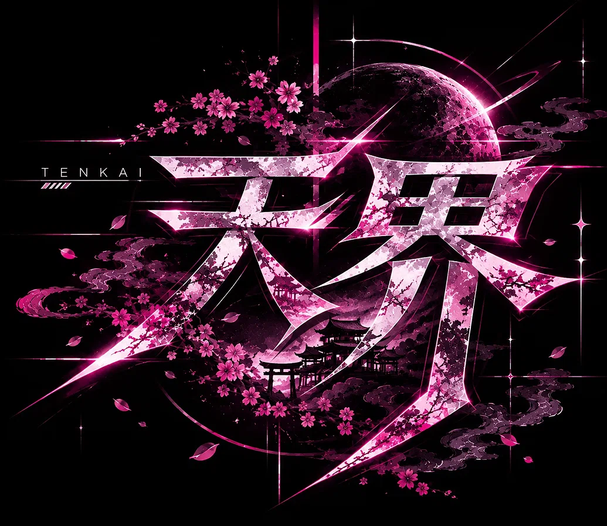

# Tenkai · 天界



**The Celestial Lite version of Ryoku Quickshell.**

[](LICENSE)


---

## Introduction

Tenkai is an **opinionated, lightweight fork of
[Ryoku](https://github.com/Ryoku-dev/ryoku)** — the same Quickshell desktop,
reduced.

Ryoku already gets the hard part right: how a Hyprland desktop should look,
move and feel. Tenkai keeps that exactly as it is. What it removes is
everything that could not justify its own weight — the AI panel, the lock
screen and the D-Bus service behind it, the network reach of the background
services, and every component that failed a necessity test.

The result is the same desktop with less in it: faster to start, lighter at
idle, and visually indistinguishable from the shell it came from. Tenkai is a
derivative work, not a competing vision.

## Features

Everything below is inherited from Ryoku and kept intact. The Tenkai work is
the subtraction.

- **The exact visual identity.** The bar, the surfaces, the palette engine and
  the motion language are unchanged — a Tenkai screenshot and a Ryoku
  screenshot are the same picture. Nothing was restyled, re-skinned or
  "improved".
- **The same core workflows.** App launcher, workspace overview, quick
  settings, wallpaper picker, clipboard history, notifications and the system
  tray all behave exactly as they did before the fork.
- **Lighter by removal.** Every component was dependency-traced and put
  through a necessity test before it was kept. Measured on a live 144 Hz
  session: **482 MB RSS / 231 MB PSS** idle, **~0.3–0.6 s CPU per 60 s**
  (live trial, 2026-11-01).
- **No AI, no lock screen, no phone-home.** The launcher's AI panel is hard
  off, the lock screen and its `org.freedesktop.ScreenSaver` service are gone,
  and the weather, radio and update probes never open a socket.
- **Nothing hidden.** Every deviation from upstream is recorded in
  [`CHANGES.md`](CHANGES.md); the pinned upstream commit is in
  [`UPSTREAM.md`](UPSTREAM.md); attribution is in [`CREDITS.md`](CREDITS.md).
- **A careful installer.** `install.sh` checks everything, asks before it
  touches anything, and backs up what it changes. `--dry-run` writes nothing.

## Common Keybinds

| Key | Action |
|---|---|
| `Super + D` | App Launcher |
| `Super + Enter` | Open Terminal |
| `Super + W` | Close Window |
| `Super + 1…4` | Switch Workspaces |
| `Super + Tab` | Workspace Overview |
| `Super + P` | Wallpaper Picker |
| `Super + V` | Clipboard History |

These ship in the bundled Hyprland config at
`src/tenkai-configs/hypr/modules/binds.lua`.

### Viewing All Keybinds

The table above is only the short list. For the complete, authoritative list of
every keybind active in your session, run this in your terminal:

```bash
hyprctl binds
```

`hyprctl` asks Hyprland itself, so it always reflects what is actually bound
right now — including anything you have added or changed since installing.

## Installation

**Requirements:** an **Arch Linux** machine running **Hyprland**. Everything
else is checked for you — the installer prints exactly what is missing and
never installs anything without asking.

```bash
git clone https://github.com/me3i/tenkai.git ~/projects/tenkai
cd ~/projects/tenkai
./install.sh
```

`install.sh` is interactive throughout: it checks dependencies, builds the
daemons, the blob plugin and the QML modules, then offers each system change
one at a time — systemd user units, the Hyprland autostart line, the kitty
colour include, your terminal dotfiles, the Hyprland config, wallpapers and
fonts. Your existing `~/.config/hypr` is never overwritten without an
interactive yes, and existing files are backed up to `*.tenkai-install.bak`
first.

```bash
./install.sh --dry-run   # print every step, write nothing
./install.sh --help      # list all flags
```

Then start it in the current session:

```bash
./tenkai status    # nothing running yet
./tenkai start     # join this Hyprland session
```

Log out and back in after enabling autostart, and your desktop is Tenkai.

## Repository layout

```
├── install.sh         the installer (see above)
├── tenkai             the control script: run / test / status / verify-untouched
├── src/
│   ├── ryoku/         the Ryoku shell tree, adapted by Tenkai
│   ├── tenkai-configs/  bundled Hyprland Lua config + terminal dotfiles
│   └── tenkai-assets/   wallpapers and OFL fonts
├── docs/              checklists, runbooks and the test suite
├── CHANGES.md         every modification vs upstream
├── CREDITS.md         attribution
├── UPSTREAM.md        the pinned upstream commit
├── NOTICE             upstream copyright and licence notices
└── LICENSE            GNU GPL v3
```

## Development

Tenkai is built and tested in a **nested Hyprland** session that never touches
your live desktop:

```bash
./tenkai test              # nested-session test suite
./tenkai verify-untouched  # prove the live session's config hashes are unchanged
./tenkai scrub-check       # prove no personal setup is tracked
```

`./tenkai verify-untouched` must pass after any change to the tree. See
[`docs/LIVE-CHECKLIST.md`](docs/LIVE-CHECKLIST.md) before running Tenkai on a
live session and [`docs/ROLLBACK.md`](docs/ROLLBACK.md) for the way back.

## Attribution and license

Tenkai is a **modified derivative of
[Ryoku](https://github.com/Ryoku-dev/ryoku)** (pinned commit
`98a0368253d9628be72b853985878a5db90e1547`, v0.75.5-beta.20, "Onogoro").
Ryoku and Tenkai are distributed under the **GNU General Public License
version 3 or later (GPL-3.0-or-later)** — see [`LICENSE`](LICENSE) and
[`NOTICE`](NOTICE).

Tenkai also builds on the work of others:

- **[Caelestia](https://github.com/caelestia-dots/shell)** — the frame-blob
  renderer, adapted by Ryoku and carried through Tenkai (GPL-3.0).
- **QS Bar** — the bar style, from HANCORE-linux's
  [Quickshell Rise](https://github.com/HANCORE-linux/quickshell-dots),
  credited at
  `src/tenkai_core/shell/quickshell/shell/modules/bar/barstyles/qsbar/Scene.qml:1`.
- **Fonts** — Space Grotesk and Fraunces, SIL Open Font License 1.1; Nerd
  Fonts glyphs for terminal coverage, each under its own licence.

Every modification against upstream is recorded in [`CHANGES.md`](CHANGES.md),
and the full attribution notice lives in [`CREDITS.md`](CREDITS.md).

Tenkai is not affiliated with, endorsed by, or connected to the Ryoku project.
